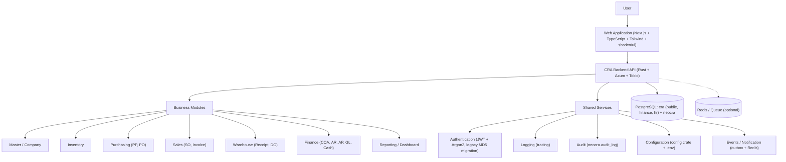

# NEOCRA Architecture (CRA ERP v1)

NEOCRA is the next-generation **CRA (Corporate Resource Application)** ERP. It keeps the business logic of the legacy Java/Spring/JSF CRA application and reuses its PostgreSQL database, while moving to an API-first, scalable, AI-ready and event-ready stack.

## Goals (phase 1)
- Main business transactions (purchasing, sales, warehouse, inventory, finance)
- Own database (existing `cra` PostgreSQL database, NEOCRA-owned objects isolated in schema `neocra`)
- API-first (OpenAPI documented REST API, the web app is just one client)
- Scalable (stateless JWT API, async Rust, connection pooling)
- AI-ready (clean typed JSON API + OpenAPI spec usable by agents/LLM tools, audit trail as training/analytics data)
- Event-ready (transactional outbox `neocra.outbox_events`, published to Redis when configured)
- Easy to integrate (REST + OpenAPI, events, Docker)

## High-level diagram



## Coexistence with legacy CRA
| Concern | Approach |
|---|---|
| Database | Same `cra` database. Legacy tables are read and written exactly as the Java app does (same numbering, same status columns). No legacy table/column is altered. |
| New objects | Only in schema `neocra`, created by SQLx migrations. |
| Users & permissions | Legacy `pengguna`, `hakakses`, `menu.roles`, `map_pengguna_cabang`, `map_pengguna_gudang`. `pengguna.roles = 'ROLE_ADMIN'` → superadmin. |
| Passwords | Legacy MD5 verified once, then re-hashed with Argon2 into `neocra.user_credentials`. Legacy column untouched (except on explicit password change, where MD5 is also updated so the old app keeps working). |
| Document numbers | Same formats as legacy, e.g. `200/CRA-PO/VI/2026`, `199/SO/CRA/VI/2026`, `071/CRA/PP/VI/2026`. |

Both applications can therefore run side by side during migration.

## Repository layout
```
NEOCRA/
├── backend/            Rust + Axum API (see backend/README.md)
│   ├── src/{main.rs, app.rs, config, database, middleware, auth, modules/*, services, events, utils}
│   └── migrations/     SQLx migrations (schema neocra)
├── frontend/           Next.js web app (see frontend/README.md)
│   └── {app, components, features, hooks, services, types}
├── docker/             Dockerfiles
├── docs/               architecture.md, api-contract.md, business-logic.md
├── docker-compose.yml
└── README.md
```

## Roadmap
- Phase 1 (this repo): foundation, auth/RBAC, master data, inventory, purchasing (PP/PO), sales (SO/invoice), warehouse (receipt/DO read), finance (read), dashboard.
- Phase 2: warehouse transactions (packing list, DO, receipt posting with stock ledger), invoicing & AR/AP payments, GL posting, Intruksi PO & forecast.
- Phase 3: HR & payroll (schema `hr`), KPI, advanced reporting, notification service, AI assistants on top of the OpenAPI spec and event stream.
